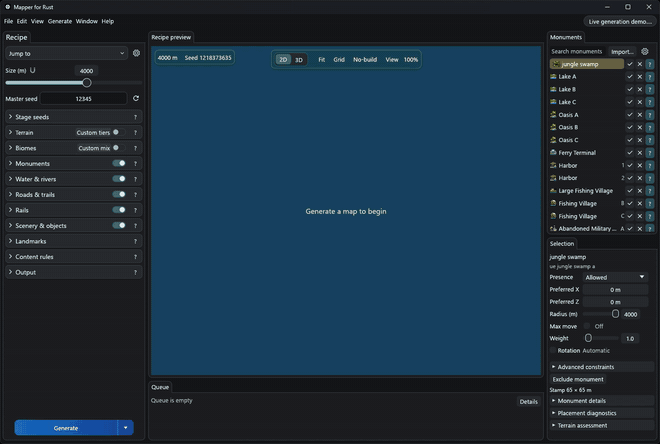

# Mapper for Rust

Mapper is a Windows desktop app for making custom maps for Rust servers. Build a recipe, generate a map, then adjust monuments or routes before exporting it.

## Live map generation

Watch a 4 km map take shape from the first terrain preview through rivers, monuments, roads, and rails.

This 22-second time-lapse shows a 1 minute 57 second run from the [visualization branch](https://github.com/Papyrus-for-Rust/Mapper-Studio/tree/visualization).

## Try the beta

1. Download the Windows x64 ZIP from [Releases](https://github.com/Papyrus-for-Rust/Mapper-Studio/releases), extract it, and open `mapper-studio.exe`.
2. Select your Rust installation. You can manage other installations from Settings. Mapper prepares the selected game files on first use and keeps a local cache for later runs.
3. Set the map size and enter a seed, or click the randomize button. Select **Generate** to open a map tab and watch the job progress.

You can queue more maps while one is running. Drag the six-dot grip on a waiting map to reorder it, or use the arrow beside **Generate** to queue a batch.

On a finished map, drag a monument to request a new position or click a road, trail, or rail to edit its spline. **Apply changes** processes the pending edits together. Use the map menu to export a `.map` or PNG.

Save a `.mapper` project to keep your maps and edits. Export a `.rec` recipe when you only want the generation settings.

## Beta limits

Mapper reads game data from your own installation. Supported builds and available features depend on what Mapper can verify there. If a map cannot be composed or exported, open its issue report in Queue. Test a map on a separate server before using it for a live wipe.

- [Build from source](docs/BUILD.md)
- [Command-line examples](docs/CLI.md)
- [Write a plugin](docs/PLUGINS.md)
- [Report a bug](https://github.com/Papyrus-for-Rust/Mapper-Studio/issues)

## Where can I host my map?

Once you export a `.map` from Mapper, put it somewhere your Rust server and players can download it without signing in.

### GitHub Releases

Open **Releases** in a public repo you control, click **Draft a new release**, and pick or create a tag. Attach the `.map` file, publish the release, then copy the link to the file under **Assets**. A link for a specific release looks like `https://github.com/your-name/rust-maps/releases/download/wipe-01/island.map`. [GitHub’s release guide](https://docs.github.com/en/repositories/releasing-projects-on-github/managing-releases-in-a-repository#creating-a-release)

### Dropbox

Upload the `.map` and copy a view-only link that anyone can open and download. Change `dl=0` to `dl=1` to start the download directly. If there’s no `dl` parameter, add `?dl=1` to a plain URL or `&dl=1` if the URL already has a `?`. Keep the rest of the link intact, including `rlkey` if it’s there. [Dropbox’s download-link guide](https://help.dropbox.com/share/force-download)

Try the link in a private browser window. If the `.map` downloads as soon as you open it, use that URL as your server’s `+server.levelurl` value. [Facepunch’s custom map hosting guide](https://wiki.facepunch.com/rust/Hosting_a_custom_map)

Mapper's original code is licensed under [AGPL-3.0-only](LICENSE). Game files and third-party components retain their own terms. Mapper for Rust is an independent project and is unaffiliated with Facepunch Studios.
